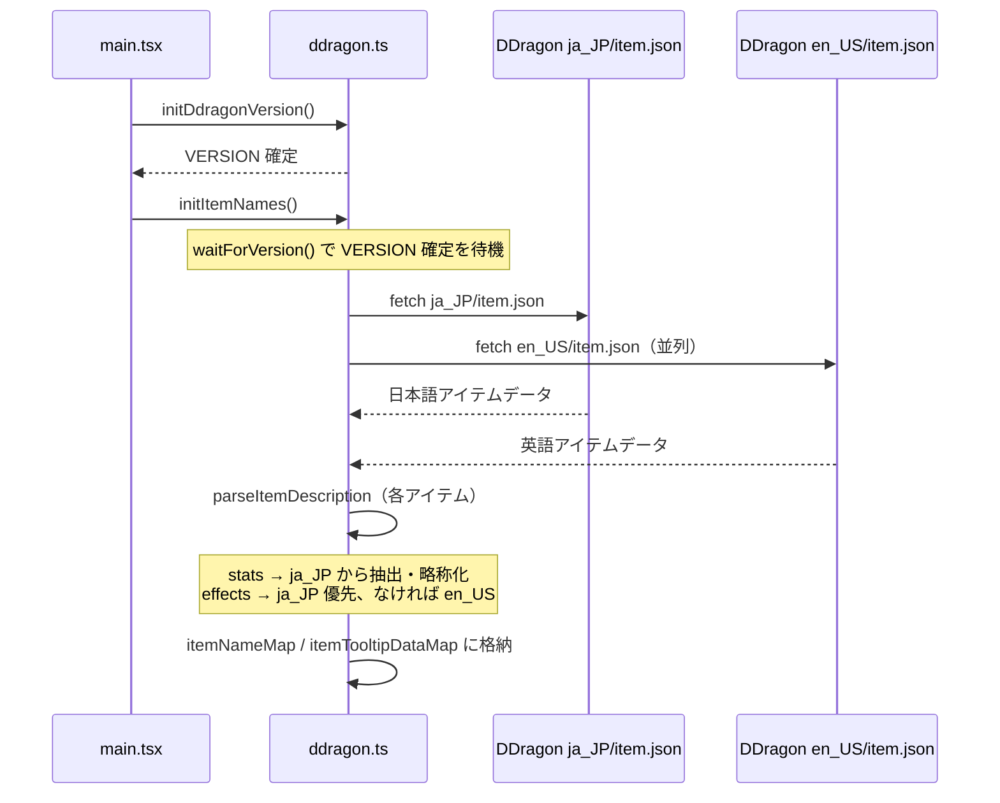
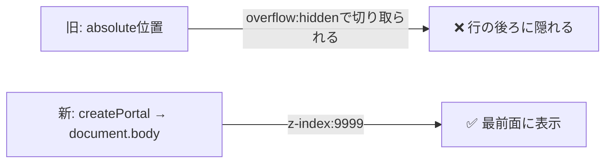

# 日報 — 2026-06-11

## 概要

デスクトップアプリ（Electron）のマッチ履歴画面に対して、**アイテム・オーグメントアイコンのホバーツールチップ機能**を実装した。
スタット略称表示・カテゴリ分類・効果テキストの日本語優先表示まで含む完全な実装を行った。

---

## 実装内容

### 1. アーギュメント（オーグメント）ツールチップ対応

**変更ファイル**
- `desktop/src/main/ipc.ts`
- `desktop/src/preload/index.ts` / `index.d.ts`
- `desktop/src/renderer/src/hooks/useAugmentMap.ts`

**追加フィールド（LCU `cherry-augments.json` 取得）**

| フィールド | 説明 |
|---|---|
| `name` | `nameTRA` — 日本語名 |
| `description` | `descriptionTRA` / `augmentDescriptionTRA` — 日本語効果説明 |

`useAugmentMap.ts` を 3 つのキャッシュ（icon / name / desc）に分離し、単一フェッチで共有する構造にリファクタリング。

```mermaid
graph TD
    A[useAugmentMap / useAugmentNameMap / useAugmentDescMap] -->|初回のみ| B[ensureLoaded]
    B --> C[window.electronAPI.lcu.fetchAugments]
    C --> D[IPC: lcu:fetchAugments]
    D -->|LCU接続中| E[/lol-game-data/assets/v1/cherry-augments.json]
    D -->|未接続 fallback| F[CDragon cdragon/arena/en_us.json]
    E --> G[iconCache / nameCache / descCache に格納]
    F --> G
    G -->|state更新| A
```

---

### 2. アイテムツールチップ対応

**変更ファイル**
- `desktop/src/renderer/src/utils/ddragon.ts`
- `desktop/src/renderer/src/main.tsx`

#### データ取得フロー



#### `parseItemDescription` アルゴリズム

```mermaid
flowchart TD
    A[description HTML] --> B{&#60;stats&#62; タグあり?}
    B -->|Yes| C[&#60;br&#62; で分割 → 各行をHTML除去]
    C --> D[abbreviateStat で略称化]
    D --> E[stats配列に追加]
    B -->|No| F[stats空]

    A --> G{&#60;li&#62; タグあり?}
    G -->|Yes| H[cleanEffectText で HTML除去・パッシブ/アクティブラベル整形]
    G -->|No| I{&#60;passive&#62;/&#60;active&#62; タグあり?}
    I -->|Yes| J[ラベルと後続テキストをペアで取得]
    I -->|No| K[effects空]

    H --> L[stripPlaceholders: {{ var }} → &#123;?&#125;]
    J --> L
    L --> M[effects配列に追加]

    E --> N[ItemTooltip: stats + effects]
    M --> N
```

#### スタット略称マッピング

| 日本語 | 略称 | カテゴリ |
|---|---|---|
| 攻撃力 | **AD** | 攻撃 |
| 攻撃速度 | **AS** | 攻撃 |
| クリティカル率 | **クリ率** | 攻撃 |
| ライフスティール | **LS** | 攻撃 |
| オムニヴァンプ | **OV** | 攻撃 |
| 脅威度 | **脅威度** | 攻撃 |
| 魔力 | **AP** | 魔法 |
| クールダウン短縮 | **AH** | 魔法 |
| 体力 | **HP** | 防御 |
| 魔法抵抗力 | **MR** | 防御 |
| 鎧 | **AR** | 防御 |
| 体力自動回復 | **HP回復** | 防御 |
| 移動速度 | **MS** | その他 |
| マナ | **MP** | その他 |
| マナ自動回復 | **MP回復** | その他 |

---

### 3. Tooltip コンポーネント実装

**変更ファイル**: `desktop/src/renderer/src/pages/DesktopHomePage.tsx`

#### ①  Portal ベースへの変更（z-index/overflow問題の解決）

旧実装は Tailwind の `group-hover` + `absolute` で実現していたが、親要素の `overflow-hidden` によってツールチップが行の後ろに隠れる問題があった。



**新しい Tooltip 実装ポイント**
- `onMouseEnter` で `getBoundingClientRect()` を取得し state に保存
- `createPortal` で `document.body` に描画
- `position: fixed` + `transform: translate(-50%, -100%)` でアイコン真上に配置
- `onMouseLeave` で state を null にしてツールチップを消す

#### ② スタット表示レイアウト

```
スタティック シヴ
攻撃  45AD  30%AS
魔法  45AP
その他  4%MS
─────────────────────
エレクトロスパーク: エネルギー充填状態の
通常攻撃で連鎖する電撃を放ち…
```

- カテゴリラベル（攻撃=オレンジ / 魔法=ブルー / 防御=グリーン / その他=グレー）を各行の先頭に配置
- 同カテゴリのスタットを横並びで表示
- 数値は白太字、略称はカテゴリ色
- `getStatCategory()`: `\b` ワード境界は `AD45` のような無スペース文字列で失敗するため、数字・%・スペースを除いた文字列の `includes()` で判定

---

### 4. 言語ポリシー

| 表示領域 | 言語 |
|---|---|
| アイテム名 | 日本語（ja_JP） |
| スタット略称（AD, MR 等） | 英略称のみ（意図的） |
| 効果テキスト | **日本語優先**、ja_JP に効果なし → en_US fallback |
| オーグメント名・説明 | 日本語（LCU `nameTRA` / `descriptionTRA`） |
| `{{ variable }}` プレースホルダー | `{?}` に置換表示 |

---

## 変更ファイル一覧

| ファイル | 変更種別 | 内容 |
|---|---|---|
| `desktop/src/main/ipc.ts` | 修正 | `fetchAugments` に `name`, `description` フィールド追加（`nameTRA`, `descriptionTRA`） |
| `desktop/src/preload/index.ts` | 修正 | `fetchAugments` 型に `name?`, `description?` 追加 |
| `desktop/src/preload/index.d.ts` | 修正 | 同上（型定義） |
| `desktop/src/renderer/src/hooks/useAugmentMap.ts` | 大幅修正 | 単一フェッチで iconCache / nameCache / descCache を共有。`useAugmentNameMap`, `useAugmentDescMap` を新規エクスポート |
| `desktop/src/renderer/src/utils/ddragon.ts` | 大幅追加 | `initItemNames()`, `parseItemDescription()`, `abbreviateStat()`, `getStatCategory()`, `ItemTooltip` 型を追加 |
| `desktop/src/renderer/src/main.tsx` | 修正 | `initDdragonVersion().then(() => initItemNames())` でアイテム名を起動時プリロード |
| `desktop/src/renderer/src/pages/DesktopHomePage.tsx` | 大幅修正 | `Tooltip` コンポーネントを Portal ベースに刷新。アイテム・オーグメントアイコンに Tooltip を適用。カテゴリ分類スタット表示実装 |

---

## 既知の制限事項

- DDragon の一部アイテム（主に新アイテム）の効果テキストはゲームクライアント側で計算される `{{ variable }}` プレースホルダーを含む。これらは `{?}` として表示され、実際の数値は示せない
- オーグメントの名前・説明は LCU 接続中（LoL クライアント起動中）でないと取得不可。未接続時は CDragon 旧形式にフォールバックするためオーグメントツールチップが空になる場合がある

---

## 次のステップ候補

- [ ] LCU `/lol-game-data/assets/v1/items.json` から日本語アイテム説明を取得（`{{ }}` プレースホルダーが解決済みの可能性）
- [ ] オーグメントツールチップ：LCU 未接続時でも表示できるよう CDragon 側でのデータ補完を検討
- [ ] アイテムに tier アイコン（コンポーネント / コアアイテム）の視覚的区別を追加
